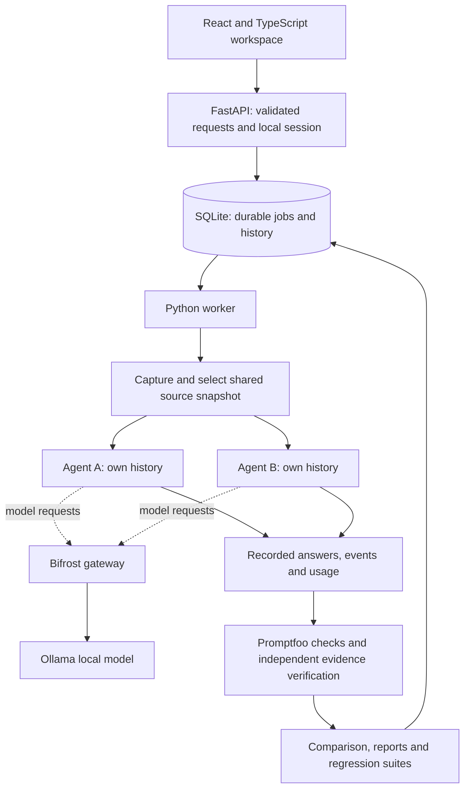

# Rilo

**Measure recovery. Inspect evidence. Repeat the test.**

[](https://github.com/Gauravwakle96/RILO/actions/workflows/verify.yml)
[](LICENSE)

Rilo is a local **AI agent benchmarking and verification workspace**. Give two independent agents the same task and captured sources, inspect their answers and execution traces, introduce controlled failures, and repeat the evaluation after a change. Developers can see **which agent met their requirements, what it consumed, and where it failed**.

Built for the Global AI Hackathon's Bifrost challenge: **[Build a Benchmarking Platform for AI Agents, Not Just Models](https://hackcultureplatform.blob.core.windows.net/event-assets/hackathons/6ac5c8240037f69fb28e23ec/problem_explanation_ck1ellfr6qh.pdf)**. The benchmark category is **research agents**; the same workspace also supports chat, repository, document and website tasks.

[Quick start](#quick-start) · [Measured results](#measured-results) · [Judge's guide](docs/HACKATHON.md) · [Architecture](#how-it-works) · [Verification](docs/RILO_2_VERIFICATION.md)


*An actual recorded benchmark: both agents passed 12/15 normal-condition attempts. Their behavior diverged when a search or model call failed. This screenshot shows the benchmark interface at the time of capture.*

## The problem

A successful agent demo can hide fragile tool handling, unnecessary calls and unsupported answers. Choosing a model alone does not tell a developer whether an agent's prompts, orchestration, tools and recovery logic work together. Comparing runs with different sources or budgets makes that decision harder.

Rilo turns that decision into an inspectable experiment: fix the inputs, record the conditions, evaluate each agent independently, and trace a failed check back to the answer, source or failed operation. Save the task as a regression suite and use it again when the agent changes.

## Measured results

On **9 November 2026**, a full research benchmark recorded **120 attempts**: two agents × five tasks × four conditions × three repetitions, using the same `qwen2.5-coder:7b` model through **Bifrost v2.5.0 → Ollama**.

| Recorded outcome | Scout: plain Python | Relay: LangGraph |
| --- | ---: | ---: |
| Passed / total attempts | 24 / 60 | 48 / 60 |
| Task success within this suite | 40% | 80% |
| Normal conditions | 12 / 15 | 12 / 15 |
| First search call times out | 0 / 15 | 12 / 15 |
| First synthesis call unavailable | 0 / 15 | 12 / 15 |
| Misleading source instruction | 12 / 15 | 12 / 15 |
| Mean attempt duration | 5.8 seconds | 10.0 seconds |

**What this reveals:** Relay's bounded recovery improved completion under the injected failures, with greater execution time. Both agents still failed the insufficient-evidence task. Rilo preserves those failures so the next improvement has a concrete test.

These are **historical measurements on controlled synthetic sources with real model inference**, not live-web accuracy or a hackathon score. The 120 attempts contain 90 actual model responses; some controlled failures prevented dispatch. Three repeated trials are a small sample, and later runs can differ.

Inspect the [methodology and limitations](docs/BENCHMARK.md), [compact results](docs/benchmark-evidence/summary-v2.json), [complete outputs and traces](docs/benchmark-evidence/model-v2.json), and [CSV](docs/benchmark-evidence/model-v2.csv). No private database is required to read these artifacts.

## Why use Rilo?

| Developer need | Rilo's implemented answer |
| --- | --- |
| Compare different agent implementations | Plain Python, LangGraph and a registered local HTTP-agent contract. Existing HTTP agents keep their implementation; unobserved internals remain unknown. |
| Understand recovery, resource use and failure | Inject a search timeout, synthesis outage or misleading instruction into the research suite; inspect activation, tool/model events, retries and outcomes. |
| Keep comparisons fair | Shared source snapshots, independent histories, recorded model/budgets, versioned checks and repeated trials. Neither agent sees its peer's answer during generation. |
| Define a useful result | Real **Promptfoo 0.125.1** assertions grade declared text/JSON requirements. The comparison shows passed checks, failures and scoped conclusions. |
| Check the source behind a finding | Inspect exact captured file lines, PDF pages or website passages. Valid references and claim correctness are reported separately. |
| Prevent the same failure returning | Save versioned suites, rerun captured tasks, compare baselines and investigate newly failed checks. Export the record as PDF, Markdown, JSON or CSV. |

Rilo's contribution is the combination of **controlled agent failures, independent execution, source verification and a repeatable developer workflow** in a local workspace. It builds on established tools: Promptfoo supplies the assertion engine and one adapted React component; Rilo supplies its worker, agent adapters, captured contexts, evidence checks, comparisons and reports. See [implementation and attribution](docs/PROMPTFOO_INTEGRATION.md).

## Five ways to use the workspace

| Workspace | Working flow |
| --- | --- |
| **Chat** | Send shared messages to two agents, keep separate histories, attach context, compare replies, cancel or retry, and export the conversation. Source-free conversation is not assigned a factual-accuracy score. |
| **Repository** | Capture a public or authorized private GitHub commit, or upload a ZIP; analyze bounded source files with real paths and line references. Python static checks, optional OSV lookups and isolated Docker test profiles add separate evidence. |
| **Documents** | Analyze PDF, DOCX, TXT and Markdown. PDF citations retain real page numbers, including scanned pages processed by local Tesseract OCR; other formats use captured line references. |
| **Website** | Capture a bounded set of public pages with robots.txt, DNS and redirect checks. A site with no readable body produces an actionable capture error. |
| **Search** | Compare research on supplied sources or explicitly enable Tavily for a shared live search. Search is off by default. |

Scout is the concise baseline; Relay adds bounded recovery. Research, Coding, Document and Customer Support Assistant profiles specialize the same engine. Custom HTTP agents support the original research contract and, when explicitly registered with compatible workspace-v1 tasks, paired workspaces. Internal usage remains unknown unless observed by Rilo.

### A real repository recovery case study

Rilo captured **40 files** from a real GitHub repository at a fixed commit. Repo Analyst and Relay independently described the project using the same selected README passage. Repo Analyst first omitted citations; its single repair attempt added them, with the original response retained in the private execution trace.

Both completed, and all six emitted citations matched captured passages. Relay took **38.44 seconds** with one model call; Repo Analyst took **65.35 seconds** with two. The configured Docker unittest runner found zero tests and returned a failure, which remains in the case study. No success checks were declared, so this run has no accuracy score or quality winner.

The public case study is an **anonymized summary of recorded results**. It preserves measurements, reference-check outcomes and event order; repository identity, source passages and raw answers are withheld. It demonstrates bounded citation recovery, with the full research benchmark above providing independently inspectable source evidence.

[Read the case study](docs/ui-evidence/repository-recovery-2026-11-10.md) · [Download PDF](docs/ui-evidence/repository-recovery-2026-11-10.pdf) · [Recorded metrics JSON](docs/ui-evidence/repository-recovery-2026-11-10.json) · [Diagnosis and verification](docs/USER_FAILURE_FIXES_2026-11-10.md)

## Quick start

**Requirements:** Git, [uv](https://docs.astral.sh/uv/getting-started/installation/), and [Node.js](https://nodejs.org/) **22.22+** (Node 24 used in CI). Python **3.13** is pinned in `.python-version`. Ollama and a downloaded model are needed for real AI responses; Docker is optional for isolated repository tests.

### 1. Install and start the workspace

```sh
git clone https://github.com/Gauravwakle96/RILO.git
cd RILO
uv sync --locked
npm ci --prefix frontend
npm ci --prefix backend/rilo/promptfoo_runtime
npm run build --prefix frontend
uv run rilo serve
```

Open **http://127.0.0.1:8018**. This starts the API, built frontend and a separate durable worker. A fresh clone starts with an empty evaluation history. The committed reports are evidence to inspect; they are not silently loaded as new results. Press `Ctrl+C` to stop the API and worker.

On Windows, `START_RILO.cmd` performs setup/build/start. After the first build, `START_RILO.cmd -SkipBuild` skips rebuilding the frontend. The lower-left **Start here** guide explains requirements and actions.

### 2. Try the workflow without a model

In another terminal, from the repository directory:

```sh
uv run rilo demo --full --wait
```

This schedules 120 **explicitly labeled deterministic fixture attempts**. It exercises scheduling, faults, traces and evaluation without an API key or model. Fixture synthesis uses Python logic, not AI inference. For a shorter UI walkthrough, choose **Try recovery example** in the guide.

### 3. Connect real local inference through Bifrost

Install and start [Ollama](https://ollama.com/). In a separate terminal:

```sh
ollama pull qwen2.5-coder:7b
uv run python scripts/setup_gateway.py --start
```

The helper downloads the official pinned Bifrost binary, configures its local Ollama provider and creates restricted gateway credentials in private `.env`. Leave the gateway running. **Restart `uv run rilo serve` after this setup** so both API and worker load the credentials. Existing model/provider settings are preserved. On Windows, `START_RILO.cmd -Gateway` can launch the project gateway and workspace together.

Check service status and run the full real-model research suite:

```sh
uv run rilo doctor
uv run rilo run examples/research-model.json --wait --timeout 2400
```

The recorded 120-attempt model run took about 16 minutes on the development laptop. Hardware, model state and load affect runtime. Both workspace agents run sequentially to fit local hardware. Core local inference needs no paid API, although hardware, downloads, electricity and optional services have their own costs.

### 4. Try a paired task with explicit checks

1. Open **Chat** and select **Scout** and **Relay**.
2. In **Supporting context**, enter: `The application stores records in SQLite. It caches lookups in Redis.`
3. Ask: `Name the database and cache in one sentence.` Add two case-insensitive contains checks: `SQLite` and `Redis`.
4. Send to both agents. Inspect the answers, check matrix, citations, usage and traces.
5. Choose **Save task as regression test**, then **Retest** or run the saved suite in **Benchmarks**. Use **Regression Lab** to compare compatible runs.

Text checks match spelling and word order literally. No checks means ungraded; two failures mean neither met the requirements. Rilo does not change a failing rule to manufacture a winner.

## How it works



**Bifrost's role:** authenticated model routing, returned model/provider metadata, token usage and observable request boundaries. Rilo records agent steps and tool behavior around those requests; gateway visibility alone does not describe an entire agent.

**Tavily's role:** optional live search before generation, with one shared capture for paired workspace tasks. The adapter has contract/error tests; **live Tavily acceptance is not yet validated because no key was configured**. GitHub ingestion, documents, readable websites and source-based chat work without Tavily.

```text
backend/rilo/
  api.py, storage.py, worker.py        API, SQLite migrations, durable execution
  agents.py, engine.py                 Research workflows and observed boundaries
  workspace_engine.py                 Independent paired task execution
  ingestion.py, snapshots.py           Input capture and content-addressed sources
  verification.py, promptfoo_checks.py Evidence verification and task assertions
  workspace_evaluation.py, reports.py  Comparisons and persisted-data reports
frontend/src/                          React workspace and reusable components
tests/                                Backend, boundary, SDK and CLI tests
frontend/tests/                       Browser workflows and opt-in live checks
docs/                                 Guides, evidence, architecture and licenses
```

Large uploads and source objects live in the ignored `.rilo/` directory, with metadata and execution records in SQLite. No extra message broker or distributed services are required. See the [architecture](docs/ARCHITECTURE.md) and [workspace API](docs/WORKSPACE_API.md).

## Configuration and developer automation

### Practical assistants

Agents opens with four focused profiles, all using the same paired execution,
captured evidence and report infrastructure:

| Assistant | Useful work | Boundary |
| --- | --- | --- |
| Customer Support | Draft a reply from supplied policies and flag human review | Does not send replies, access accounts or process refunds |
| Document | Answer knowledge questions, find clauses and compare passages | Analyzes selected passages; pages must come from the captured document |
| Coding | Explain repositories and review requested code issues | Suggests changes as text; tests require the opt-in isolated runner |
| Research | Compare pages, dates and conflicting source statements | Public URLs work directly; web discovery requires optional search |

Select **Use assistant**, then **Load example** to populate an editable task,
source and explicit success checks. Policy/release examples are labeled synthetic;
the coding example retrieves a real public GitHub repository. Loading does not
dispatch work. Scout and Relay remain available under reference agents, and
registered local adapters have their own category. Developers can put the same
assistant in both slots and compare its models, prompts or versions.

These are Rilo profiles powered by the selected model, not integrations with
commercial help desks or coding products. Previous analyst IDs and version 2.0.0
records are retained; new tasks use the updated versioned profiles.

Use [.env.example](.env.example) as the reference. Keep credentials in private `.env`, which is excluded from Git.

| Setting | Purpose |
| --- | --- |
| `RILO_BIFROST_URL`, `RILO_MODEL` | Local gateway endpoint and selected model. The helper starts Bifrost on port 8086. |
| `BIFROST_API_KEY` | Private gateway credential generated by the helper or configured for your gateway. |
| `TAVILY_API_KEY` | Optional live search; select Tavily in the UI only after configuration. |
| `BYNARA_API_KEY` | Optional Bynara inference. Select `bynara/agnes-2.5-flash`; credentials remain in the backend. |
| `AGENTROUTER_API_KEY` | Optional AgentRouter inference. Select `agentrouter/MODEL_ID` per comparison side; credentials remain in the backend. |
| `RILO_OFFLINE` | Disable new external retrieval, remote inference and unobserved HTTP adapters; local Ollama and captured sources remain available. |
| `GITHUB_TOKEN` | Optional authorized private-repository access. Never sent to agents. |
| `RILO_SANDBOX_IMAGE` | Optional preinstalled Docker image pinned by digest for fixed test profiles. |
| `RILO_WORKSPACE_INPUT_BYTES` | Bounded serialized input; defaults to 6,000 bytes. Increase only after validating model context. |
| `RILO_MODEL_PRICING_JSON` | Optional explicit token-price map. Missing usage/pricing stays unknown. |
| `RILO_DATA_DIR` | Private local storage; defaults to `.rilo`. |
| `RILO_REPOSITORY_FILE_LIMIT`, `RILO_REPOSITORY_BYTE_LIMIT` | Bounded GitHub capture; defaults to 200 files and 12 MB. |
| `RILO_OCR_LANGUAGE` | Local Tesseract language identifier; defaults to `eng`. |
| `RILO_HOSTED`, `RILO_PUBLIC_URL`, `RILO_ALLOWED_HOSTS`, `RILO_ALLOWED_ORIGINS` | Optional authenticated hosted mode behind HTTPS. |

Restart the API and worker after changing environment variables. Search availability, provider reachability, model availability and worker readiness are shown separately.

Chat captures a single public URL in your task or the explicit website input before
both agents answer. This uses bounded website retrieval without requiring Tavily.
Search discovery remains an optional Tavily feature. An inference API by itself
does not browse. AgentRouter requests use its OpenAI-compatible endpoint directly;
local Ollama requests continue through Bifrost. **A configured key is not proof of
authentication: use Dashboard → Check an actual model response → Test inference.**

Bynara is also optional: save `BYNARA_API_KEY` privately and choose
`bynara/agnes-2.5-flash` or another model listed by the provider. Requests use the
fixed `https://router.bynara.id/v1/chat/completions` endpoint. The live account check
returned a model list and a real `agnes-2.5-flash` response with observed token
usage. `auto/bynara` was not listed; `agnes-3-flash` returned insufficient-credit
HTTP 402 on this account. Those other models remain unavailable. Provider pricing
stays unknown in USD unless explicitly configured.
Both paired agents also completed a saved Bynara evaluation with matched source
references and observed usage. The application ships with Ollama as its default;
the current installation selects Agnes 2.5 at the user's request. You can switch
back to `ollama/qwen2.5-coder:7b` in Settings for local inference.

The workspace also supports independent per-side model, agent version, instructions,
temperature and bounded recovery controls; the same profile can occupy both sides.
Inspect captured sources to focus the next task. Define literal or JSON checks,
save multiple captured cases in a suite, and use Reports to search all evaluations.
Settings provides offline policy, storage usage, orphan-file cleanup and private
backup downloads.

Reports also provides reversible archive/restore and confirmed deletion with
dependency protection. Edit A/B candidates on a finished paired task to rerun
the original captured sources and checks. Benchmarks saves whole-suite batches,
case links, combined recorded metrics and resumable missing cases. Repository
supports bounded local folder import as well as ZIP/GitHub input. Long chats can
continue with disclosed excerpts of each agent's own history; full originals stay
saved. Human claim reviews remain separate from automated reference checks.
PDF reports embed licensed fonts for Latin, Greek, Cyrillic, Devanagari and Arabic.
Unsupported glyphs return an explicit error with Markdown/JSON alternatives.

Website capture falls back to fixed TLS-verified Cloudflare DNS-over-HTTPS only
when the OS resolver fails, revalidates all addresses and pins public connections.
Connected retrieval may send the queried hostname to that resolver. Offline mode
blocks retrieval entirely. Search accepts an explicit public URL without Tavily;
general web discovery still needs a configured search provider.

Restore a private backup into a new empty folder, run a saved suite case, or retest
a captured evaluation:

```sh
uv run rilo restore --archive rilo-private-backup.tar.gz --destination .rilo-restored
uv run rilo suite-run SUITE_ID --case 0 --wait
uv run rilo retest EXPERIMENT_ID --wait
```

Normal Windows launch reuses installed dependencies and built assets. Use
`START_RILO.cmd -Update` after updating source, and `-NoBrowser` to suppress the
automatic dashboard opening. See [local product delivery notes](docs/LOCAL_PRODUCT_IMPLEMENTATION.md)
for current verification evidence and remaining limits.

The Python SDK and CLI support repeatable research benchmarks:

```sh
uv run rilo baseline EXPERIMENT_ID --name "Research reference"
uv run rilo compare --baseline BASELINE_EXPERIMENT_ID --candidate CANDIDATE_EXPERIMENT_ID --require-pass
uv run rilo report EXPERIMENT_ID --output reports/evidence.json
```

The CLI comparison exits `0` for pass, `1` for a measured regression and `2` for inconclusive evidence. Declare agent changes explicitly with `--allow-agent-changes`; incompatible task, model, source or grading conditions do not become a valid ranking. See [SDK and HTTP-agent integration](docs/DEVELOPERS.md).

## Verification and boundaries

The **13 November 2026 storage reliability verification** records **257 passing
Python tests with 83% coverage** and **3 passing targeted browser checks** in
[STORAGE_STATUS_FIX_2026-11-13.md](docs/STORAGE_STATUS_FIX_2026-11-13.md).
The preceding full standard browser suite had **27 passes and 8 explicit skips**;
practical-agent live results, build, typing, lint and dependency checks are in
[PRACTICAL_AGENTS.md](docs/PRACTICAL_AGENTS.md), alongside the earlier
[local product implementation](docs/LOCAL_PRODUCT_IMPLEMENTATION.md).
These are dated checks, not a guarantee of error-free behavior; the badge above
links to the current GitHub workflow.

The [11 November publication checks](docs/PUBLICATION_VERIFICATION.md) reran all **198 Python tests** with **84.13% coverage**, plus backend/frontend lint, types and build checks. GitHub CI runs separately on the published source.

```sh
uv run ruff check backend/rilo tests scripts examples
uv run mypy backend/rilo
uv run pytest --cov=rilo --cov-fail-under=80
npm run lint --prefix frontend
npm run typecheck --prefix frontend
npm run build --prefix frontend
```

For browser tests, start the API/worker with an idle queue, then run from `frontend/`: `npx playwright install chromium` and `npm run test:e2e`. The suite uses actual local fixture jobs; explicitly labeled boundary simulations and opt-in live-model checks are separate. [Full verification record](docs/RILO_2_VERIFICATION.md).

- **Deployment:** local mode remains the default. Optional hosted mode adds persistent accounts, CSRF-protected sessions and per-user ownership for evaluations, conversations, uploads, snapshots, reports, suites and private catalog entries. It is a single-instance SQLite deployment behind an HTTPS reverse proxy; see [hosted deployment](docs/HOSTED_DEPLOYMENT.md).
- **Evidence:** source integrity is different from factual correctness. Semantic review is advisory; repository accuracy requires suitable independent ground truth.
- **Repositories:** bounded capture and passage selection, not a complete security audit. Private GitHub access has not undergone live acceptance without credentials.
- **Untrusted inputs:** SSRF/DNS/redirect checks, archive path checks, upload/response bounds, session/CSRF protection and secret redaction have automated coverage. Optional repository code runs in constrained Docker containers with no host mounts or network; this is not an independent security certification.
- **Documents and websites:** scanned PDF pages use bounded local Tesseract OCR when installed; recognition errors remain possible. Page scripts are not executed, so JavaScript-only content may need a readable URL or pasted text. PDF exports support the bundled fonts' Latin, Greek, Cyrillic, Devanagari and Arabic glyphs; unsupported glyphs return an explicit error.
- **External acceptance:** live Tavily and live private-GitHub acceptance require credentials. The private GitHub path and provider contracts are tested without fabricating a live credential result.
- **Statistics and fees:** small repeated samples are not broad reliability claims. Unknown metrics remain unknown; local zero-rate API estimates exclude compute and energy.

## Documentation and attribution

| Read next | Contents |
| --- | --- |
| [Judge's guide](docs/HACKATHON.md) / [Pitch outline](docs/PITCH.md) | Challenge mapping, demo sequence and submission summary |
| [Workspace guide](docs/RILO_2_GUIDE.md) | Inputs, profiles, checks, reports and requirements |
| [Benchmark evidence](docs/BENCHMARK.md) | Research results, methodology, preserved failures and raw records |
| [Developer guide](docs/DEVELOPERS.md) / [Deployment](docs/DEPLOYMENT.md) | SDK, CLI, local startup, storage and troubleshooting |
| [Implementation](docs/RILO_2_IMPLEMENTATION.md) / [Verification](docs/RILO_2_VERIFICATION.md) | Delivered capabilities, test evidence and remaining work |
| [Promptfoo integration](docs/PROMPTFOO_INTEGRATION.md) / [Third-party notices](THIRD_PARTY_NOTICES.md) | Actual upstream reuse, licenses and boundaries |

Rilo source is **Apache-2.0**. Original synthetic research fixtures are **CC0**. Reused Promptfoo code is **MIT** with attribution; fonts retain their **OFL** notices. The anonymized repository case study publishes execution measurements and verification outcomes without redistributing the analyzed project's source. Model weights and downloaded gateway binaries are not included. Historical plans are preserved in the documentation and are not additional completion claims.

Built by [Gaurav Wakle](https://github.com/Gauravwakle96). Pronounced **REE-loh**.
