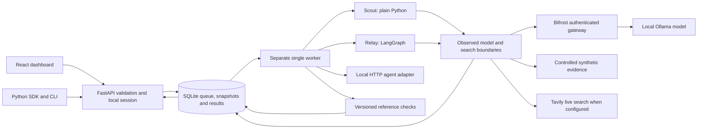

# Rilo architecture and engineering contracts

> RILO 2 workspace expansion: see [implementation status](RILO_2_IMPLEMENTATION.md), [workspace API](WORKSPACE_API.md), [guide](RILO_2_GUIDE.md), and [fresh verification](RILO_2_VERIFICATION.md). Earlier scope notes below describe the preserved benchmark foundation.


Updated 9 November 2026. The first local release is implemented. The sections below retain some architecture targets for later releases; [API_CONTRACT.md](API_CONTRACT.md) is authoritative for supported routes and [BACKEND.md](BACKEND.md) describes current behavior. The implementation uses Python's standard SQLite driver with explicit transactions and schema versioning, avoiding SQLAlchemy/Alembic for this small single-worker release. Team tenancy, arbitrary native plugin imports, JUnit exports and remote execution are future scope.

## Implemented data flow



Current package: `api.py` validates/admit requests, `schemas.py` defines request/output contracts, `storage.py` owns SQLite transactions/leases/snapshots, `worker.py` executes bounds/cancellation, `engine.py` observes service boundaries and injected faults, `agents.py` contains independent workflows/adapters, `evaluation.py` grades and compares, `catalog.py` holds versioned synthetic tasks, and `client.py`/`cli.py` expose developer automation. React feature components call the typed client in `frontend/src/lib/api.ts`. UI progress uses bounded polling; SSE is available to API clients.

## 1. Stack and deployment decisions

| Component | Selection | Reason and trade-off |
| --- | --- | --- |
| Frontend | React, Vite, TypeScript | Suitable for interactive comparisons; server-rendered SEO is not needed for a private dashboard |
| API | Python/FastAPI with Pydantic validation | Matches the Python agent ecosystem and supports explicit typed API contracts |
| Execution | Separate Python worker process | Long experiments persist independently of browser/API requests |
| Local storage | SQLite standard driver, schema version table | Small local footprint; controlled write concurrency; explicit transactions; future schema changes need explicit migrations |
| Team storage later | PostgreSQL replacing SQLite for that deployment | Needed when concurrent writers and tenant operations justify it; do not deploy both as primary stores |
| Model boundary | Self-hosted Bifrost | Required integration; model routing, observed usage, and compatible provider access |
| Local inference | Ollama, user-configured capable model | Existing hardware executes inference; fee basis is explicitly configured rather than inferred from a model name |
| Research | Tavily plus a controlled-evidence search adapter | Live integration and fair evidence comparisons |
| Initial example agents | Plain Python and LangGraph | Demonstrates different implementations; LangGraph is an example adapter dependency, not the core runtime |
| Progress | Server-sent events with reconnect cursor | One-way progress is sufficient initially; avoid adding bidirectional infrastructure prematurely |

A durable database-backed queue is adequate for one local worker. Job leasing, crash recovery, transactional admission, and cancellation must be tested. Adopt Redis/Celery or another mature broker only when multiple workers/hosts and measured needs justify it.

FastAPI BackgroundTasks is not the durability mechanism for experiments. SQLite transaction control must be explicit for the chosen Python/SQLAlchemy versions; enable and test foreign keys, short transactions, a busy timeout, and an appropriate journal policy. Do not imply SQLite supports unrestricted concurrent writers.

## 2. Proposed project structure

```text
rilo/
  frontend/
    src/app/                 navigation and application shell
    src/features/            agents, suites, experiments, traces, comparison
    src/components/          accessible reusable UI
    src/lib/                 API client and event reconnect logic
  backend/
    rilo/api/                validated HTTP routes and authorization
    rilo/domain/             task, scenario, experiment, and assessment rules
    rilo/adapters/           existing-agent invocation and instrumentation
    rilo/runner/             jobs, leases, fresh state, cancellation, limits
    rilo/boundaries/         model/tool dispatch, fault injection, usage
    rilo/evaluation/         graders, aggregation, comparison compatibility
    rilo/storage/            repositories, transactions, migrations
    rilo/reporting/          redacted JSON/CSV/JUnit exports
    rilo/config/             configuration and credential references
  sdk/python/                supported invocation/event contract
  cli/                       headless run, compare, export, and doctor
  task-packs/research/        versioned tasks and licensed/synthetic fixtures
  examples/                  plain Python and LangGraph integrations
  tests/                     unit, contract, integration, and browser checks
  docs/                      setup, architecture, API, evaluation, limitations
  .env.example               variable names and placeholders only
  pyproject.toml             declared Python dependencies
  uv.lock                    pinned Python resolution when implemented
```

Keep agent business behavior outside the benchmarking engine. A new task pack should usually add task definitions and graders, not change core scheduling.

## 3. Agent adapter contract

An adapter supplies registration metadata, a health check, declared capabilities, run invocation, observable events, and cancellation behavior.

Run input includes run ID, task version, reference time, tool/model endpoints, evidence mode, scenario version, limits, and declared configuration. Output includes bounded final output, execution outcome, available usage, and artifact references.

Supported integration paths:

- Python callable adapter: wrapper around an existing entry point; native callbacks can emit trace events.
- HTTP adapter: invoke an existing agent endpoint using a documented envelope; optional callback/event stream.
- Later CLI adapter: argument-vector invocation with stdin/stdout protocol and isolated execution.

No arbitrary shell string is accepted as a local registration shortcut. Python imports and executables represent code execution and need a trusted local plugin or isolated runner policy.

Capabilities are explicit: model observations, tool observations, agent-step events, model fault injection, tool fault injection, controlled corpus support, cancellation, and resource limits. Missing capabilities cannot be inferred from a final answer.

A configuration/wrapper may be necessary, but the agent's internal control loop should not be rewritten. A completely opaque remote endpoint can be tested for final outcomes; it cannot be advertised as fully traced or fully fault-tested.

## 4. Observation and fault injection

Rilo's boundary wrapper records eligible calls before/after dispatch and applies a versioned scenario when its trigger matches. Bifrost remains the real model gateway; wrapper-level injected responses are identified as test events.

Each event has a run ID, monotonic sequence, UTC timestamp, event type, span/parent IDs where available, origin, bounded payload, and redaction status. Event types include run_start, step, model_request, model_response, tool_request, tool_response, fault_injected, limit_reached, validation_error, and run_end.

Store observable actions and supplied concise decision summaries. Do not require hidden chain-of-thought or invent internal reasoning from logs.

Fault triggers use explicit call eligibility, count, and bounded duration. Record whether the trigger actually activated. Instrumentation and fault channels must use run-specific authorization so one agent cannot alter another run.

Cache settings, warm-up policy, and actual fallback models are part of the experiment manifest. Cached answers and fallback model changes can affect conclusions and must be visible.

## 5. Data model

| Entity | Key fields and invariants |
| --- | --- |
| Project | ID, display name, local/team scope, retention policy |
| AgentVersion | Agent ID, immutable version, adapter type, config hash, capabilities, credential references |
| SuiteVersion | Immutable suite ID/version, task memberships, rubric versions |
| TaskVersion | Input contract, reference time, expected behavior, evidence/rubric references |
| EvidenceSnapshot | Hash, source URI, collection time, allowed content, license/retention metadata |
| ScenarioVersion | Trigger, effect, eligibility, bounds, expected permitted behavior |
| Experiment | Immutable manifest, selected versions, limits, state, scheduling policy |
| RunAttempt | Experiment/task/agent/scenario IDs, repetition, timestamps, outcome, lease, prior interrupted-attempt reference |
| TraceEvent | Run ID plus unique sequence, parent span, type, payload reference, provenance |
| Assessment | Run ID, grader version, pass/fail/inconclusive, evidence, calibration metadata |
| UsageRecord | Request ID, measured/estimated/unknown provenance, tokens, credits, fee basis and timestamp |
| Baseline | Pinned comparable experiment/configuration and release policy |
| Artifact | Content hash, type, size, retention/access policy, storage reference |

Local event/metadata storage starts in SQLite; larger permitted artifacts use a private filesystem directory with database references. Neither location is served as an unrestricted static web directory. Hosted object storage is a later change.

New versions are created instead of mutating task/rubric definitions used by existing results. Aggregates retain the number of eligible attempts, invalid attempts, activated scenarios, and unknown assessments.

## 6. Proposed API

All routes are under /api/v1. Request IDs and typed errors support diagnosis. The local service binds to loopback by default and requires an application session credential; CORS alone is not authentication.

| Route | Contract |
| --- | --- |
| GET /health | Service health; detailed dependency status requires authorization |
| POST /agents | Register validated adapter metadata and credential references |
| POST /agents/{id}/versions | Create an immutable configuration version |
| POST /agents/{id}/check | Run bounded connectivity/capability preflight |
| GET /suites | List available versioned suites |
| POST /suites | Create/import schema-validated tasks without executing embedded code |
| GET /scenarios | List supported scenarios and their capability requirements |
| POST /experiments | Validate manifest, reserve limits, enqueue; return 202 plus experiment ID |
| GET /experiments/{id} | State, progress, manifest, available results |
| GET /experiments/{id}/events | SSE stream with resumable cursor and bounded payloads |
| POST /experiments/{id}/cancel | Request idempotent cancellation; return actual state |
| GET /runs/{id}/trace | Paginated/redacted observed events |
| GET /runs/{id}/assessments | Grader results and evidence |
| POST /comparisons | Check compatibility and compare selected experiments |
| POST /baselines | Pin a versioned baseline and policy |
| GET /reports/{id} | Authorized export with explicit redaction/content policy |

POST /experiments accepts an idempotency key to avoid duplicate queued work. Duplicate event sequences are rejected or deduplicated; an SSE reconnect resumes after the last persisted sequence.

Errors include code, message, request ID, retryable flag, and safe details. Typical statuses: 400 invalid operation, 401 authentication, 403 authorization, 404 unavailable object, 409 state/version conflict, 422 schema validation, 429 admission/resource limit, and 503 dependency unavailable. Do not expose credentials or raw stack traces.

Comparison can display mismatched experiments for inspection, but strict ranking/regression gates require compatible manifests or explicitly accepted changes. Instrumentation or grading gaps are surfaced as inconclusive.

## 7. Persistence, recovery, and limits

- Transactionally admit jobs and reserve configured quotas before work starts.
- A worker claims a renewable lease; expired leases trigger interruption accounting.
- Persist events incrementally with unique sequence IDs and bounded batches.
- Make job enqueue/cancellation idempotent; never reuse a completed run ID for a retry.
- On restart, preserve completed evidence and explicitly account for interrupted attempts.
- Bound model calls, tool calls, retries, wall time, output/artifact size, and supported process resources.
- Local concurrency starts at one; scale only after storage and resource behavior are measured.
- Cancellation stops scheduling and asks the adapter to abort. Adapters that cannot stop in-flight work expose that limitation; late usage is reconciled.
- Usage reservations are estimates until actual provider usage arrives. Unknown billing is not zero, and a hard guarantee against externally incurred in-flight charges is not claimed.
- Local API fee accounting is separate from machine time and any estimated energy/compute cost.

## 8. Security and privacy boundaries

Research agents initially receive read-only research tools. Tool/model responses, task files, imported reports, and agent outputs are untrusted data and require schema/size validation and safe rendering.

Local mode uses trusted adapters and explicitly registered endpoints. A subprocess timeout or a Git worktree is not an OS security sandbox. Untrusted code and later coding/action packs require validated container/VM/process-isolation policies, read-only base inputs, scoped writable scratch space, and restricted network access.

Keep provider credentials in backend environment/OS credential storage with references in configuration. Redact credentials and sensitive identifiers from requests, traces, exports, and exception messages. Raw content logging is opt-in with retention controls; model-provider transmission is governed by each project's policy.

Agent endpoints and callback destinations require allowlisting and validation. Handle redirects, private addresses, DNS rebinding, and metadata endpoints according to deployment mode; explicitly registered local agents are a deliberate local exception, not an unrestricted hosted fetch capability.

Hosted mode requires authentication, project-level object permissions, owner/maintainer/viewer roles, parameterized queries, safe uploads, resource quotas, CORS policy, CSRF protection where cookie authentication is used, and isolated runners. A local session token does not constitute team authorization.

Use synthetic canaries in instruction-resistance tests. Preserve test text as data; do not expose real credentials to an adversarial fixture. Production actions are not replayed automatically. Plugins and custom graders are executable extensions and require an explicit trust model.

Retention/deletion applies to traces, artifacts, snapshots, and backups. Full third-party source text may not be redistributable; public fixtures use synthetic or appropriately licensed content.

## 9. Testing and deployment checks

Unit tests: admission rules, scenario triggers, sequence accounting, versioning, limits, aggregation, comparison compatibility, and output validation.

Contract tests: adapters, Bifrost model boundary, Tavily tool boundary, event envelopes, usage provenance, SSE reconnect, cancellation, and error schemas. Contract mocks are labeled; they do not replace real integration runs.

Integration tests: actual local model through Bifrost, actual bounded Tavily search, restart recovery, interrupted attempts, database migrations, credentials redaction, retention, and representative faults.

Browser checks: keyboard navigation, accessible tables/charts, focus, reduced motion, real progress/error states, and representative 360/768/1440 px layouts using project Playwright or ECC Chrome DevTools.

Release checks when implementation exists: Python tests and type/lint checks, frontend lint/typecheck/tests/build, npm audit, uvx pip-audit against the locked Python environment, targeted secret scanning, dependency/license review, and reviewed diff. Public marketing pages later need metadata, heading, indexing, and SEO checks; the private dashboard is not a public SEO surface.

Document model hardware needs, startup/shutdown, environment variables, provider configuration, database backup/migrations, cache behavior, recovery limits, and known unsupported adapters. Pin dependencies and gateway/model revisions when reproducible integration runs are available.
