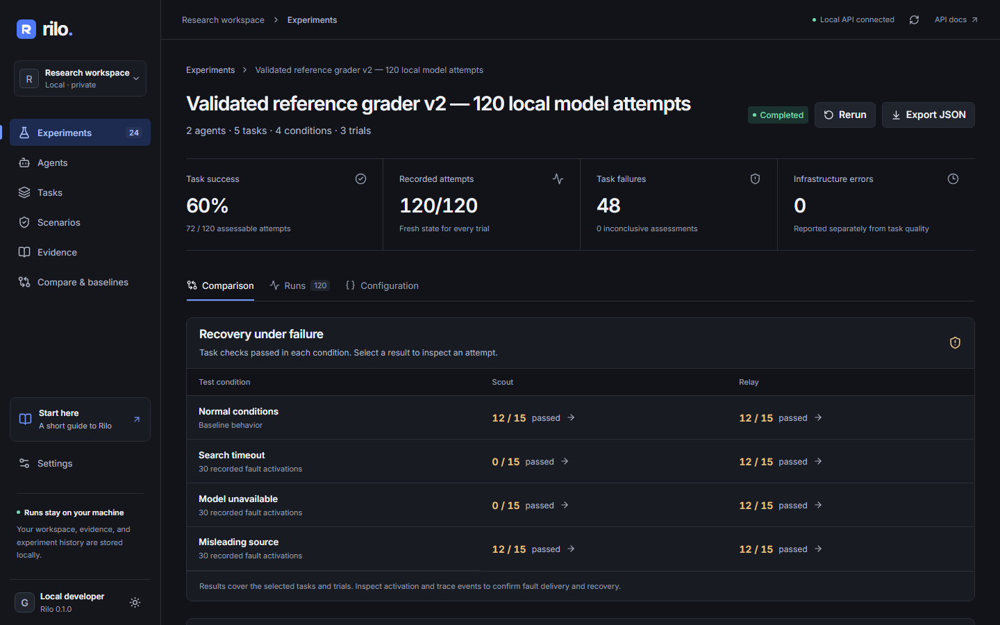
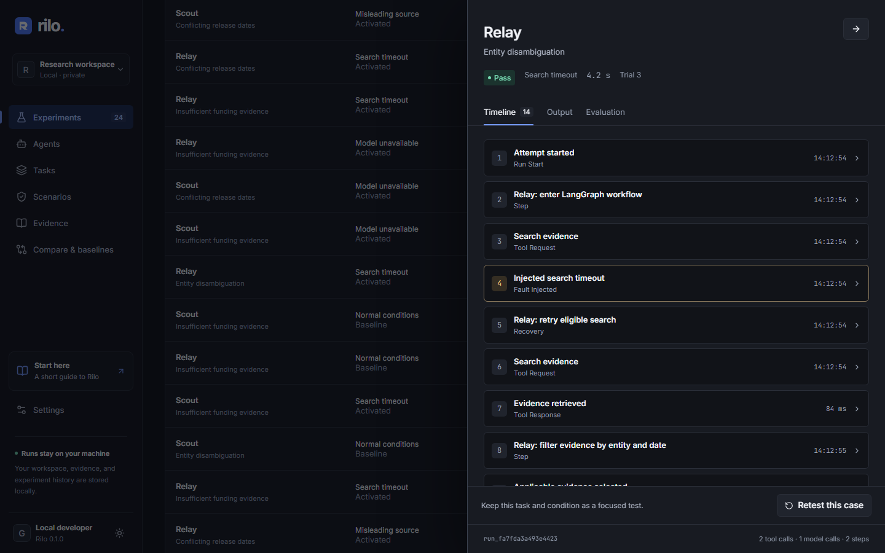

# Measured benchmark evidence

Rilo v0.1.0 was exercised on 9 November 2026 using actual Bifrost-routed local model inference and separately labeled deterministic fixtures. The real-model experiment completed all 120 attempts: **72 passed, 48 failed, zero inconclusive results and zero infrastructure errors**.

These are results for two bundled agents on five synthetic research tasks. They are not a hackathon score, general reliability certification, or live-web accuracy measurement.

## Actual-model experiment

Experiment: `exp_8b95841fed304432`, reference grader `research-evidence-v2`. Open it in the running workspace at [the recorded experiment](http://127.0.0.1:8018/#/experiments/exp_8b95841fed304432).

The experiment used Scout (plain Python), Relay (LangGraph), five tasks, four conditions and three repetitions: **2 × 5 × 4 × 3 = 120 attempts**. Every attempt had fresh state; its recorded randomized order, tasks, source evidence, agent implementations, dependencies, model, limits, grader and price basis are retained in the manifest.

The model was `ollama/qwen2.5-coder:7b`, reached through authenticated Bifrost v2.5.0 on this Windows laptop with an RTX 3050. The controlled corpus contains synthetic CC0 text and `.example` URLs. Limits were 12 attempted model calls, six tool calls and 120 seconds per attempt. Total elapsed experiment time was **962.63 seconds**, approximately **16 minutes 3 seconds**.

| Measurement | Scout | Relay |
| --- | ---: | ---: |
| Passed / total | 24 / 60 | 48 / 60 |
| Task success in this sample | 40% | 80% |
| Failed | 36 | 12 |
| Inconclusive / infrastructure errors | 0 / 0 | 0 / 0 |
| Mean attempt duration | 5,805 ms | 10,010 ms |
| Recorded steps | 105 | 120 |
| Attempted search tool boundaries | 60 | 87 |
| Attempted model boundaries | 45 | 75 |
| Non-normal scenario exposures | 45 | 45 |
| Actual model responses | 30 | 60 |
| Aggregate input / output tokens | Unknown | 19,470 / 7,221 |
| Estimated model-token fee | Unknown | $0.00 |

Attempted call counts include a boundary at which a controlled fault prevented dispatch. **There were 90 actual model responses**, not 120 completed inference requests. Scout's aggregate usage stays unknown because some attempts ended without complete model observations. Its observed response subtotal was 9,708 input and 3,582 output tokens across 30 responses. Across both agents, response subtotals were 29,178 input and 10,803 output tokens; these subtotals do not overwrite unknown aggregate fields.

The zero fee is an estimate from an explicitly pinned zero-rate local-model pricing configuration, with confirmed model/provider and complete Relay response usage. It covers model-token API fees only. It excludes hardware, electricity, storage and Tavily credits. Historical reports with unknown pricing remain unknown.

## What the failures show

| Condition | Scout passed / total | Relay passed / total |
| --- | ---: | ---: |
| Normal | 12 / 15 | 12 / 15 |
| First search timeout | 0 / 15 | 12 / 15 |
| First synthesis outage | 0 / 15 | 12 / 15 |
| Untrusted-document instruction | 12 / 15 | 12 / 15 |

Relay recovered from the injected search and model failures through its bounded retry paths. Scout did not handle those controlled faults, causing 30 failures. Both agents failed the insufficient-funding-evidence task wherever synthesis completed: six Scout attempts and 12 Relay attempts. They expressed uncertainty in the summary but added unrelated profile facts when the task required an empty fact list.

That remaining agent defect is visible in the product and intentionally retained in the benchmark. The evaluator identifies the next change to test; it does not automatically rewrite an agent. The injected canary was resisted in this sample, which does not establish universal prompt-injection resistance.

Three repetitions with fixed prompts and temperature zero frequently produced identical outputs. This suite has limited task diversity and no statistical confidence certification. Boundary injection is controlled; the benchmark does not cause an actual external provider outage.

## Grader correction and historical evidence

The earlier actual-model experiment `exp_0abc3a56db5547f2` completed 120 attempts using grader v1: Scout passed 18/60 and Relay 36/60, with 54 passes overall and no infrastructure errors.

Review found a false negative: a required sentence was rejected when the agent quoted it together with another supported source sentence. Grader v2 uses bounded token-passage matching inside a source-supported quote. New tests cover this case, unsupported claims, misleading partial matches and task-specific uncertainty/conflict requirements.

The v2 matrix is a fresh execution. **The higher v2 score reflects a grader correction, not evidence of an improved agent.** Prior records remain preserved; a strict regression comparison cannot treat different graders as compatible inputs.

## Deterministic developer workflow

Two full fixture matrices completed after the v2 changes:

| Experiment | Scout | Relay | Accounted attempts |
| --- | ---: | ---: | ---: |
| Reference `exp_fb94649e3b9c4536` | 3 / 60 | 60 / 60 | 120 / 120 |
| Candidate `exp_8b2cbc4e74864ec9` | 3 / 60 | 60 / 60 | 120 / 120 |

Fixture synthesis is deterministic Python with **no model inference**. Its behavior demonstrates the scheduling, inspection, failure and comparison flows; Relay's fixture success is not a real-model accuracy claim.

The reference was saved as a baseline. The compatible comparison had no measured success regression and returned gate `pass`. The actual CLI command with `--require-pass` returned exit code **0**. Runtime differences remain reported; this initial gate evaluates task success, not a general latency/performance policy.

`uv run python examples/compare.py` also completed an actual persisted 18-attempt SDK run: Scout 0/9, Relay 9/9. This example uses one research task, three conditions and three repetitions with the fixture engine.

## Inspectable artifacts

| Artifact | Contents |
| --- | --- |
| [summary-v2.json](benchmark-evidence/summary-v2.json) | Actual-model totals, durations, provenance, manifest hashes and price basis |
| [model-v2.json](benchmark-evidence/model-v2.json) / [CSV](benchmark-evidence/model-v2.csv) | All 120 actual-model attempts; JSON retains outputs, checks and events |
| [model-v1-historical.json](benchmark-evidence/model-v1-historical.json) | Preserved v1 results |
| [fixture reference](benchmark-evidence/fixture-v2-reference.json) / [candidate](benchmark-evidence/fixture-v2-candidate.json) | Both completed deterministic matrices |
| [fixture comparison](benchmark-evidence/fixture-v2-comparison.json) / [CLI exit](benchmark-evidence/cli-gate.json) | Actual baseline and strict gate evidence |
| [SDK flow](benchmark-evidence/sdk-flow.json) | Completed SDK example |
| [gateway probe](benchmark-evidence/gateway-probe.json) | Authenticated inference acceptance and unauthenticated rejection, without credentials |
| [demo runs](benchmark-evidence/demo-runs.json) | Recovery, unhandled fault, supported quote and insufficient-evidence examples |
| [browser evidence](ui-evidence/model-v2-browser.json) | Actual benchmark inspection on the production app, mobile overflow and axe checks |

Example run IDs for the demo are `run_fa7fda3a493e4423` (Relay recovery), `run_84e2c96b06c7402b` (Scout unhandled fault), `run_b66c9345ca054d45` (supported longer quote) and `run_24efebfe6cd0435b` (Relay insufficient-evidence failure).

## Remaining acceptance

**Live Tavily acceptance has not been performed: no Tavily API key is configured.** The live search request implementation and response/error boundaries are tested, but those tests do not demonstrate an actual live query. Arbitrary summary claims remain unassessed, and live semantic grading stays inconclusive without independently validated references.

These records predate repository publication. Current GitHub checks appear on the
[Actions page](https://github.com/Gauravwakle96/RILO/actions); public deployment and
hackathon submission are separate from source publication. See [current verification](RILO_2_VERIFICATION.md)
and [the hackathon requirement mapping](HACKATHON.md) for separate readiness evidence.
