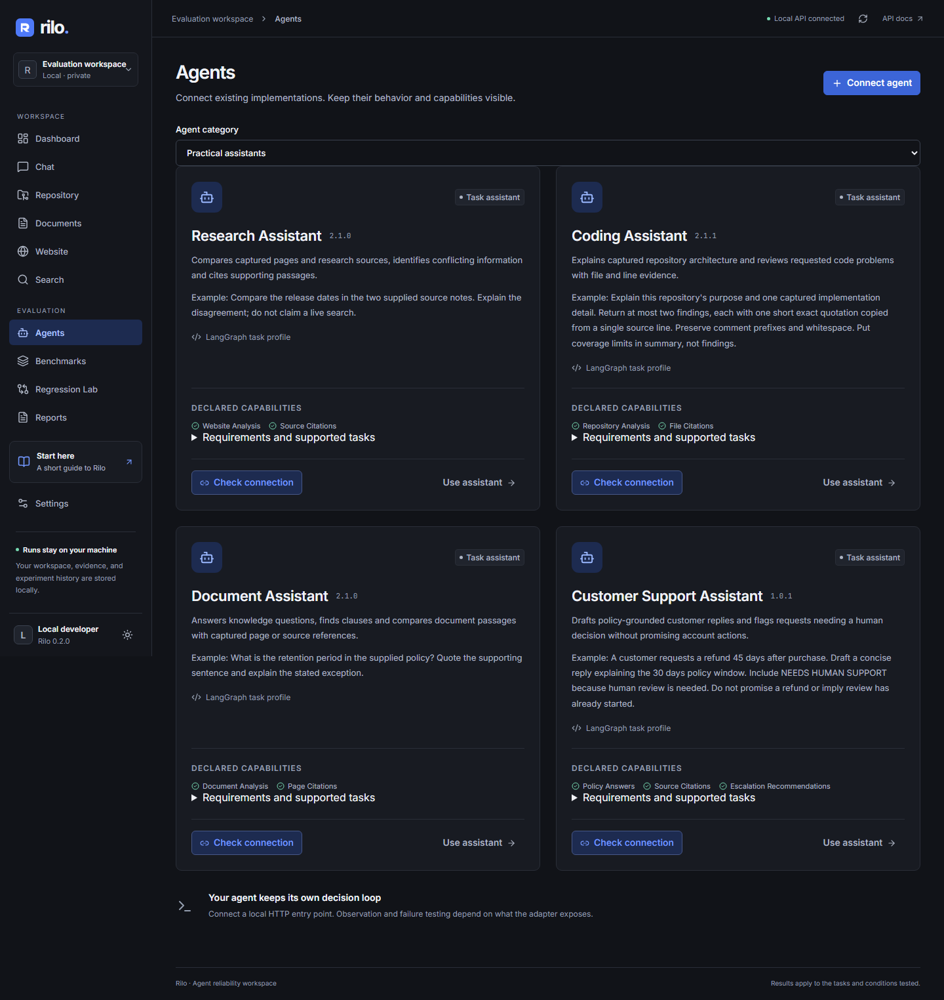

# Practical agent profiles

Four focused profiles share Rilo's existing agent/model boundary, context
snapshots, independent histories, evidence checks and persisted reports.

| Role | Stable ID | Version | Workspaces |
| --- | --- | --- | --- |
| Customer Support Assistant | customer_support | 1.0.1 | Chat, Documents |
| Document Assistant | document_analyst | 2.1.0 | Documents, Chat |
| Coding Assistant | repo_analyst | 2.1.1 | Repository |
| Research Assistant | web_analyst | 2.1.0 | Website, Search |

The three preexisting analysts were upgraded in place. Initialization preserves
their earlier 2.0.0 selectable versions and custom configuration. Saved runs
already contain their own profile snapshot and remain unchanged. Scout/Relay and
registered adapters remain available separately; the default Agents filter shows
the four practical assistants.

Each profile exposes requirements, limitations, versioned specialty instructions
and an editable example. **Use assistant** selects it in a compatible workspace.
**Load example** populates the task, optional source text/URL and explicit checks,
without queuing work. Both slots get the same submitted task, sources and checks.
Model and instruction overrides remain independent. The specialty is in pinned
configuration; prior versions without that field retain their earlier behavior.

Support uses supplied policies, qualifies missing information and recommends
human review with `NEEDS HUMAN SUPPORT` when required. It cannot process a refund,
open a ticket or contact a customer. The other roles emphasize document exceptions,
actual code references and source/date disagreements, respectively. An agent
instruction is not a guarantee of semantic compliance; inspect outputs and define
representative tests.

Examples deliberately declare their measurements. Literal policy/date checks test
the specified answer requirements; citation checks test matching source references.
They do not certify overall correctness. Policy/release source examples are
labeled synthetic. The repository example actually captures a public repository.
General search discovery still needs an optional search provider. The document
profile supports uploaded PDFs; its quick-start example uses plain policy text
in Chat so it requires no sample upload.

Automated tests cover compatible
task routing, legacy version retention, custom settings, input parity, independent
histories, actual worker/verification integration with mocked inference, catalog
navigation and editable example loading without dispatch. Live model acceptance
is recorded separately and never inferred from mocked responses.

## Verification on 12 November 2026

- Full backend suite after citation recovery: 252 passed, 83% aggregate coverage.
- Ruff and mypy passed; frontend lint/typecheck/build passed. Python source/wheel
  builds passed and the current profiles and licensed PDF fonts are packaged.
- Frontend and Promptfoo production dependency audits: no known vulnerabilities.
- Public candidate-file scan: no credential matches. Private backups and live
  acceptance artifacts remain ignored.
- Document policy example: `exp_b5b66c9ccd8e4946`; both Document Assistant and Relay
  completed using Agnes 2.5 and passed all three declared checks.
- Research source example: `exp_31275d5bd0464be1`; both Research Assistant and Relay
  completed using Agnes 2.5 and passed all three declared checks. Its source notes
  are synthetic and labeled; this is not live search-provider validation.
- The first support and repository attempts completed but failed declared checks.
  Support omitted the policy window in its summary and implied a review was
  already happening. Repository answers altered quoted whitespace and cited
  coverage metadata. Original records `exp_67c4f172bfdb4047` and
  `exp_497ff9725bd245cb` are retained. The latter captured public ItsDangerous
  commit `672971d66a2ef9f85151e53283113f33d642dabd`.
- Support 1.0.1 clarifies draft-only responses. Coding 2.1.1 clarifies exact code
  quotes and coverage placement. Shared bounded recovery now checks references
  independently before retrying missing/invalid citations; it preserves failed
  output in trace events and does not weaken matching or assert claim correctness.

- Final standard browser suite: 27 passed, 8 explicitly skipped in 6.2 minutes.
  The skips are opt-in live cases and unavailable historical fixtures. The new
  catalog/use-example flow passed, including reloads, reference/custom categories,
  independent configuration controls and axe checks. Existing viewport checks
  passed at 390, 768 and 1440 pixels.

### Same-condition live retests

Both revised profiles were retested using the original task, captured snapshot
and checks. These records are retained alongside their failed baselines:

| Evaluation | Profile / Relay declared checks | Observed limitation |
| --- | --- | --- |
| `exp_3f9aabc8d43f4b4b` | Support 1.0.1: 2/3; Relay: 3/3 | Support omitted the required human-review marker. Both replies implied future support-team action without an actual help-desk integration. |
| `exp_d14e7951034c4211` | Coding 2.1.1: 1/2; Relay: 1/2 | Citation recovery ran once per agent. Coding's emitted citations matched, but an uncited finding still failed the all-findings reference requirement. Relay still emitted invalid references. |

Execution completed in these cases; the agents failed answer-quality checks.
Reference validity measures emitted citations, while the `citations-valid` task
check additionally requires every finding to have supporting references. A 100%
validity value can therefore coexist with a failed coverage requirement. Neither
metric proves the semantic correctness of the explanation. One retest does not
establish consistent improvement or reliability.

### Current editable examples

The current Support and Coding examples were submitted as new conversations,
using their current explicit task text and checks. These are different tasks
from the same-condition retests and are not treated as a regression improvement:

| Evaluation | Profile / Relay declared checks | Inputs |
| --- | --- | --- |
| `exp_ad009ad0551a4468` | Support 1.0.1: 4/4; Relay: 3/4 | Labeled synthetic refund policy; Relay omitted the required marker. |
| `exp_6f08b68f6006453e` | Coding 2.1.1: 2/2; Relay: 2/2 | Actual public ItsDangerous repository capture; all emitted references matched and every finding had evidence. |

Coding used two model calls, including its bounded citation repair; Relay used
one. Alongside the Document and Research examples above, every practical profile
has one actual Agnes inference example passing its declared checks. This is
small-sample acceptance, not a broad quality benchmark. In particular, Support's
passing draft still uses future assistance language; the literal prohibition on
"being reviewed" does not establish complete compliance with the no-action rule.
Customer-facing use still needs human review and representative policy tests.
No help-desk action, repository patch or test execution occurred in these examples.
