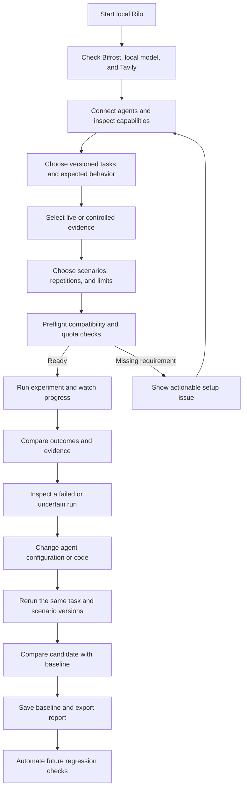
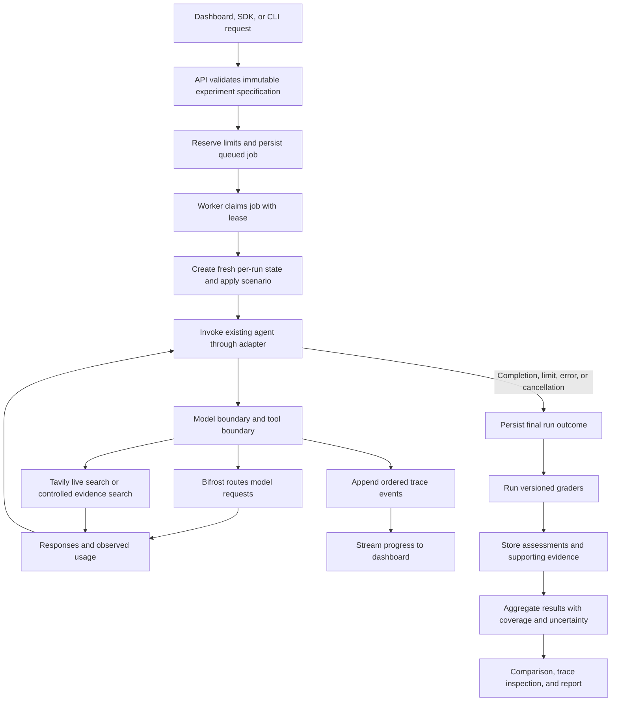
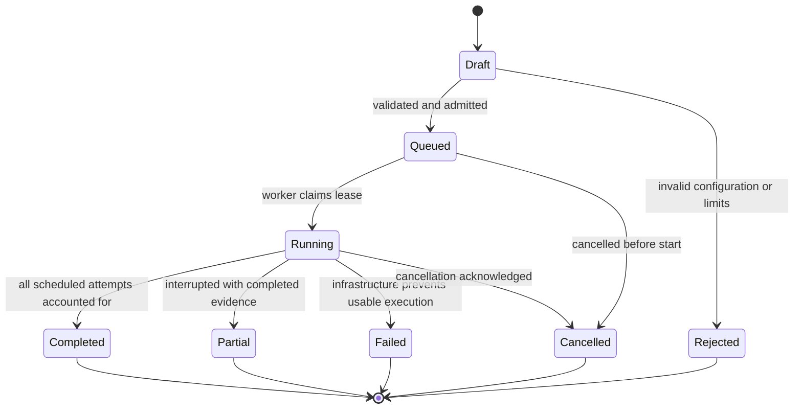
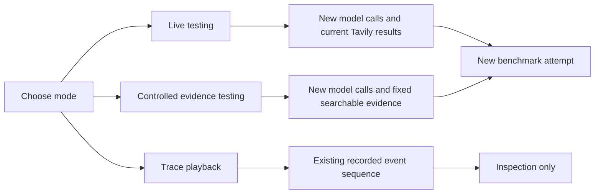
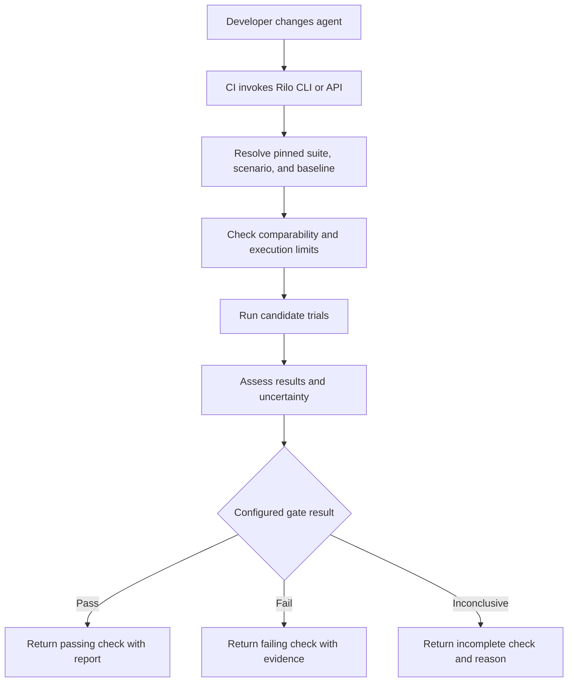

# Rilo workflows

Updated 9 November 2026. Core local flows are implemented: create, execute, inspect, rerun, baseline, compare, cancel and export. The diagrams retain future team/replay improvements where indicated. API clients can use SSE; the current dashboard polls persisted state. Trace inspection displays recorded events, and fixture synthesis is separately labeled as an executable demonstration.

## 1. Developer journey

The developer chooses the agent changes. Rilo runs and evaluates the configured experiments.

## 2. Execution pipeline

The model/tool boundary is where supported fault injection and measurement occur. Bifrost model logs alone do not establish every agent step or tool call. Adapters report observation coverage.

## 3. Experiment and attempt states

Completed means execution accounting is complete; it does not mean the agents passed. Individual attempts separately record completed, timed_out, limit_reached, cancelled, infrastructure_error, or adapter_error. Assessment results separately record pass, fail, or inconclusive.

Worker restart marks an expired in-progress attempt interrupted. Retrying creates a new attempt with a new identifier and fresh state. Replay does not silently resume a partially completed external action.

## 4. Research example

1. The developer selects two agent versions and a company-briefing task with a pinned meeting/reference time.
2. Rilo verifies the agents can use the model and research tool boundaries required by the selected scenarios.
3. In controlled mode, both agents can search the same fixed permitted corpus. They may choose different queries and actions.
4. A normal trial records baseline behavior.
5. A fault trial fails the first eligible search call. The trigger is recorded; a trial in which the trigger never occurs is marked not activated.
6. Rilo observes whether the agent retries within limits, uses another permitted source, reports uncertainty, or fails.
7. Graders check the versioned output contract and expected facts/citations. Unresolved semantic judgments remain inconclusive.
8. Comparison shows outcomes, attempts, coverage, observed requests/tokens, runtime, and grader evidence.
9. The developer changes recovery behavior and repeats the same conditions.

## 5. Replay distinction

A source snapshot controls evidence availability, not the model's randomness. A trace viewer reproduces the record of what happened, not a new successful run.

## 6. Developer-beta release check

CI publication is a later integration. No repository, pull request, deployment, external message, or release is changed by preparing this plan. The default beta behavior is returning a result and report; deployment decisions remain in the developer's existing workflow.

## 7. Error and recovery behavior

| Condition | Intended behavior |
| --- | --- |
| Model or Tavily unavailable during preflight | Do not admit a live experiment; explain which dependency failed |
| Dependency failure deliberately injected during a run | Record trigger and observe the agent's recovery |
| Unexpected outage in the runner or gateway | Record infrastructure error; preserve partial trace; do not pretend the agent was evaluated |
| Output fails schema validation | Record invalid output with bounded text and validation evidence |
| Token/tool/time limit reached | Stop admission of further work; record limit and charged/unknown usage |
| User cancels | Stop scheduling, signal active adapter, preserve evidence, acknowledge actual cancellation state |
| Instrumentation unavailable | Display unknown metrics and unsupported scenarios; block strict comparison where necessary |
| Missing corpus/fixture coverage | Report evaluation infrastructure gap, not an agent failure |
| Semantic evidence insufficient | Inconclusive assessment with explanation |
